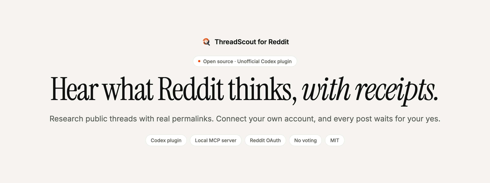
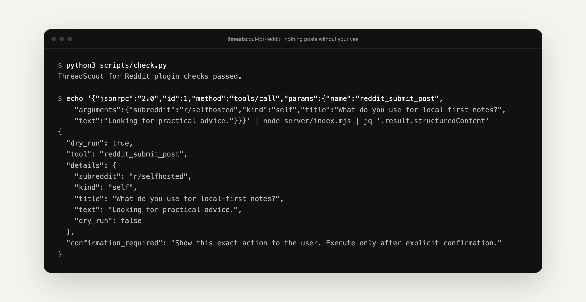

<p align="center">
  <picture>
    <source media="(prefers-color-scheme: dark)" srcset=".github/assets/banner-dark.png">
    
  </picture>
</p>

<p align="center">
  <strong>Reddit research for your AI agent, with sources you can click.</strong><br>
  An open-source Codex plugin that reads public Reddit threads, cites the original permalinks, and only posts to your account after you approve the exact preview.
</p>

<p align="center">
  <a href="#install"><strong>Install</strong></a> ·
  <a href="#connect-your-reddit-account-optional"><strong>Connect Reddit</strong></a> ·
  <a href="#what-it-can-do"><strong>Tools</strong></a> ·
  <a href="PRIVACY.md"><strong>Privacy</strong></a> ·
  <a href="CONTRIBUTING.md"><strong>Contribute</strong></a>
</p>

<p align="center">
  <a href="LICENSE"></a>
  
  
  
</p>

<p align="center">
  
  <br><sub>A real run: asking the bundled MCP server to post returns a <strong>preview</strong>, not a post. Nothing is sent to Reddit until you confirm.</sub>
</p>

> [!NOTE]
> ThreadScout is an independent, unofficial project. It is not affiliated with, endorsed by or sponsored by Reddit, Inc.

## Why ThreadScout

Reddit is where people say what they actually think about products, tools and problems. But asking an AI assistant "what does Reddit say?" often gets you a confident summary with no sources, invented consensus, or a mix of old and new threads.

**ThreadScout gives your agent a careful research method and a safe account connector.** It searches several phrasings and communities, links every claim to the original thread, says when the sample is small or skewed, and treats Reddit text as data rather than instructions. If you connect your own account, it can read your inbox and draft posts, but every public or destructive action is shown to you first.

<table>
  <tr>
    <td width="33%" valign="top">
      <h3>🔗 Sources, not vibes</h3>
      Answers point to original Reddit permalinks with subreddit and age. No invented quotes, votes or percentages.
    </td>
    <td width="33%" valign="top">
      <h3>✋ Preview before posting</h3>
      Posts, comments, messages, edits, deletes and moderation return a dry run first. They run only with <code>confirmation=confirmed</code>.
    </td>
    <td width="33%" valign="top">
      <h3>🔐 Your keys stay home</h3>
      You sign in on Reddit itself. The refresh token stays on your machine (macOS Keychain). No voting tool, ever.
    </td>
  </tr>
</table>

## Ask it things like

```text
Use $reddit-agent to find recent Reddit discussions about local-first software.
Use $reddit-agent to summarize the strongest arguments for and against this product category.
Use $reddit-agent to draft a post asking r/<community> for practical advice about <topic>.
```

With an account connected:

```text
Use $reddit-agent to show my unread Reddit inbox.
Use $reddit-agent to review my moderation queue and suggest actions without taking them.
```

## Install

```sh
codex plugin marketplace add mihirkavi/reddit-agent
codex plugin add threadscout-for-reddit@threadscout-marketplace
```

Start a new Codex task afterwards so the skill loads. Public research needs no credentials. The account connector needs **Node.js 20+** and has no npm dependencies.

To install from a local clone, replace `mihirkavi/reddit-agent` with the path to your clone. To validate a change:

```sh
python3 scripts/check.py
(cd plugins/threadscout-for-reddit/server && npm test)
```

## What it can do

| | Capability | Needs | Status |
| --- | --- | --- | --- |
| 🔎 | **Research and synthesis** of public threads, with permalinks and sampling caveats | Nothing | ✅ Skill |
| ✍️ | **Drafting** posts, titles, comments and mod messages (drafting never publishes) | Nothing | ✅ Skill |
| 👤 | **Read your account**: identity, feeds, search, saved, hidden, history, subscriptions, inbox | Approved Reddit OAuth app | ✅ 8 read tools |
| 📝 | **Act on your account**: post, comment, edit, delete, save, subscribe, message, report | Approved Reddit OAuth app | ✅ Preview + confirm |
| 🛡️ | **Moderate** where your account has permission | Approved app + mod rights | ✅ Preview + confirm |
| 🗳️ | **Voting or karma actions** | — | 🚫 Never (Reddit policy) |

<details>
<summary><strong>All 18 MCP tools</strong></summary>
<br>

| Group | Tools |
| --- | --- |
| Sign-in | `reddit_auth_status`, `reddit_auth_start`, `reddit_auth_disconnect` |
| Read | `reddit_get_me`, `reddit_list_feed`, `reddit_search`, `reddit_get_post`, `reddit_get_user_activity`, `reddit_list_subscriptions`, `reddit_get_inbox`, `reddit_get_mod_queue` |
| Write (preview first) | `reddit_submit_post`, `reddit_comment`, `reddit_edit`, `reddit_delete`, `reddit_account_action`, `reddit_send_message`, `reddit_moderate` |

The server is a single dependency-free Node.js file speaking MCP over stdio: [`plugins/threadscout-for-reddit/server`](plugins/threadscout-for-reddit/server). The skill and its research, writing and account guides live in [`skills/reddit-agent`](plugins/threadscout-for-reddit/skills/reddit-agent).

</details>

## Connect your Reddit account (optional)

Reddit requires explicit approval before any app can use its Data API, and creating a Devvit app does **not** give you the OAuth client this connector needs.

1. Read Reddit's [Responsible Builder Policy](https://support.reddithelp.com/hc/en-us/articles/42728983564564-Responsible-Builder-Policy) and use its API request form.
2. Explain that this is an open-source, local, user-directed assistant that never automates voting and confirms public or destructive actions. Ask for OAuth access with this redirect URI:

   ```text
   http://127.0.0.1:8714/callback
   ```

3. In a new Codex task, say: `Use $reddit-agent to connect my Reddit account. My approved Reddit client ID is <client-id>.`
4. Open the link it returns and approve on Reddit. Never paste your password or tokens into chat.

<details>
<summary><strong>How tokens are stored</strong></summary>
<br>

The connector stores the refresh token locally: in the macOS Keychain on macOS, or in a user-only configuration file elsewhere. It refreshes short-lived access tokens automatically. No credentials, cookies or API keys are stored in this repository, and the project owner never receives your token. See [PRIVACY.md](PRIVACY.md).

</details>

## How it works

The skill picks a mode: **research**, **synthesis**, **writing** or **account**. Research favors original permalinks, recent and diverse discussions, and explicit caveats about sampling. Writing checks community context when possible and produces a draft, never treating that as permission to publish. Account work goes through the local MCP server, which returns a dry-run preview for every write until you confirm.

## Honest status

- **Early and unofficial.** Version 0.2.0. The plugin checks and the server's unit test pass, but the account tools have not been exercised against a live, Reddit-approved OAuth app in this repository.
- **Account access depends on Reddit.** Without Reddit's approval, only public research works. OAuth scopes, subreddit rules, rate limits and account permissions still apply.
- **Public pages can be unavailable** to automated browsing, deleted, quarantined or behind sign-in. The agent reports the gap instead of claiming full coverage.
- **Not included:** voting, chat-room automation, awards and purchases, account security changes, media upload, arbitrary API pass-through or browser workarounds.
- **Reddit is anecdotal.** Discussions carry selection bias. Treat them as lived experience to investigate, not polling, professional advice or verified fact.

<!-- project-artwork:start -->
<p align="center">
  
  <br><sub>Conceptual project artwork, not a product screenshot. <a href="assets/brand/README.md">Asset notes</a>.</sub>
</p>
<!-- project-artwork:end -->

## Contributing

Issues and focused pull requests are welcome. Please keep the core plugin usable without credentials, avoid collecting personal data, and add only capabilities that can be described and tested honestly. See [CONTRIBUTING.md](CONTRIBUTING.md) and report security issues as described in [SECURITY.md](SECURITY.md).

## License

Released under the [MIT License](LICENSE).

<p align="center">
  <br>
  <br>
  <sub><strong>ThreadScout for Reddit</strong> · Research with receipts.</sub>
</p>
